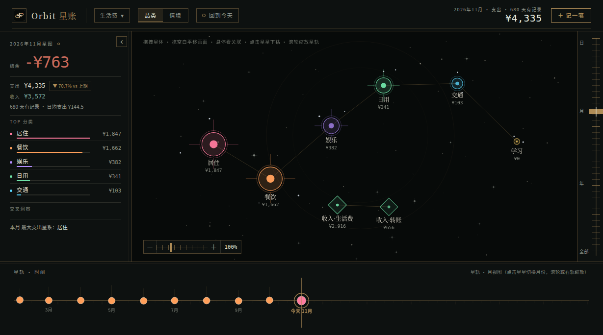

# Orbit（星账）

> **桌面端（Windows / Linux）、网页版、Android APK 都可用。** 桌面端是完整工作台；手机端有独立移动编排，
> 支持 SAF 选择真实文件夹、备份导入导出、横屏和系统返回键。iOS 暂未打包。

> **每一笔支出都是一颗流星。**
> 它划过某一天、某一月、某一年，留下一道轨迹 —— Orbit 把这些轨迹连成星轨（Orbit 就是「轨道」）。
> 于是「钱花在哪了」不再是一串数字，而是一片能一眼看清的夜空。
> 偶尔有几颗反向划过的星，那是收入。

**[在线试用](https://fogjw.github.io/orbit-ledger/)**（免安装，打开即用） ·
**[下载桌面端（Windows / Linux）](https://github.com/Fogjw/orbit-ledger/releases/latest)** ·
**[下载 Android APK](https://github.com/Fogjw/orbit-ledger/releases/latest)**



## 这是什么

一个**本地优先的个人记账软件**：用关系图谱代替流水账和饼图 —— 花销与分类构成一张图，
节点大小就是金额，让你一眼看清"钱花在哪、哪些花销之间有牵连"。

它和其他记账 App 最不一样的地方：

- **你的账本存在你自己的电脑里**，不上传、不联网、不需要注册账号；
- **记账不逼你填一堆字段**：金额、日期就够，没选的维度会自动归到「未分类」，之后再补也来得及；
- **界面是活的**：花销会浮成星图，时间是一条能拖动的星轨（日 → 月 → 年 → 全部），
  点开任一分类还能下钻看它内部的细分与每一笔花销；
- **可以交给 AI 助手记账**：内置 MCP 接口，让支持 MCP 的 Agent 直接帮你记账、建标签、查统计。

## 下载与安装

### 方式一：桌面端（推荐）

#### Windows

1. 到 [Releases](https://github.com/Fogjw/orbit-ledger/releases/latest) 下载 `Orbit-Setup-<版本>.exe`（约 108 MB）。
2. 双击安装。向导里有两处可以自己定：
   - **安装位置**（默认在系统盘的用户目录下，想放 D 盘就改这里）；
   - **账本数据位置**（默认 `%APPDATA%\Orbit 星账`）。
     想让它跟程序分开、或者放进自己的同步盘，就在这一栏改。
3. 装完会自动创建桌面与开始菜单快捷方式，双击即用。

Windows 的两个容易踩的点：

- **装过旧版本再装新的**：向导会显示「检测到本机已安装 Orbit 星账，请选择处理方式」，
  默认勾选「1. 在原有位置更新（推荐）」。选它 → 一路下一步 → **程序原地更新，账本位置一个字都不改**。
  只有你主动选「2. 换一个位置安装」，才会问路径。
- **关掉窗口 ≠ 退出程序**。关窗后它继续待在右下角托盘里（这样浏览器直连和 AI 助手都能照常用）。
  要真正退出：**右键托盘图标 → 退出 Orbit 星账**。想让它重新读取数据位置设置，也必须这样退一次再启动。

#### Linux

到同一个 [Releases](https://github.com/Fogjw/orbit-ledger/releases/latest) 下载：

- **Debian / Ubuntu 用 `.deb`**：`sudo apt install ./Orbit-<版本>-amd64.deb`。
  安装时会处理 Chromium 沙箱（用户命名空间不可用时设置 SUID；Ubuntu 24+ 还会安装 AppArmor 配置）。
- **Fedora / RHEL 用 `.rpm`**：`sudo dnf install ./Orbit-<版本>-x86_64.rpm`（或 `sudo rpm -i ...`）。
  同样由安装包处理沙箱与桌面入口。

Linux 提供 **deb 与 rpm**，不提供 AppImage。

Linux 下账本默认在 `~/.config/Orbit 星账/orbit.db`。
托盘依赖桌面环境的 StatusNotifier/AppIndicator：若桌面不显示托盘图标，关窗后应用可能仍在后台，
**再启动一次 Orbit 即可唤回窗口**；窗口菜单「文件 → 退出」可彻底退出。
如果托盘完全不可用，应用会把关窗降级为退出，不会留下无入口的后台进程。

### 方式二：Android

到 [Releases](https://github.com/Fogjw/orbit-ledger/releases/latest) 下载：

```text
Orbit-Android-<版本>.apk
```

- 可覆盖安装旧正式版；如果旧版是 debug 包，签名不同，需要先卸载一次。
- 首次打开选择存放方式：
  - **存成真实文件** → Android 系统文件夹选择器（SAF），在所选目录生成 `orbit.db`；不需要全盘存储权限，授权会持久化。
  - **存在浏览器里** → App 内部 WebView 存储；清应用数据会丢，需要定期导出。
- 备份：账本菜单 → 导出备份，会打开系统分享面板；导入备份会打开系统文件选择器。
- 硬件返回键会先关浮层/读数账笺，再退出 App。
- Android 端没有 MCP 接口。

### 方式三：网页版（免安装）

打开 <https://fogjw.github.io/orbit-ledger/> 就能用，功能与桌面端基本一致，**数据也存在你自己这台设备上**。

- 首次打开会先让你选存放方式：**存成真实文件**（支持 File System Access 的 Chrome / Edge）
  会在选定目录里生成 `orbit.db`，可备份、可拷走；**存在浏览器里**则使用浏览器内部存储，
  **清站点数据会丢**，需要定期导出备份；
- 手机浏览器只显示浏览器存储；Android APK 才有系统文件夹选择器（SAF）；
- 上次目录权限失效时，会提示“继续使用上次目录”，不会悄悄打开一个空账本；
- 网页版**没有** MCP 接口（那需要本地服务），要让 AI 助手记账请用桌面端。

## 怎么用

### 记一笔

右上角「＋ 记一笔」：填金额、日期，选品类（不选也行，会落到「未分类」）。
顶部有「支出 / 收入」两个页签 —— **收入请切到收入页签**，它的类目是单独的（以「收入」开头），
在星图上会画成绿色的四角星，和花销的星体明显不同。

### 手机端

- 顶部是品牌/账本/维度 + 当天/记一笔；下面是结余条和全屏星图；
- 底部导航：**星图 / 读数 / ＋记一笔**；
- 读数账笺复用桌面左栏的全部数据；
- 星轨头部有「日 / 月 / 年 / 全部」四档，右轨在移动端隐藏；
- 双指缩放、单指平移；系统返回键先关最上层；
- 记一笔打开时金额为空并自动聚焦，日期直接在月历上点。

### 看懂界面

| 区域 | 它在说什么 |
|---|---|
| 中间星图 | 每个分类一颗星，**面积 = 金额**；点星星下钻看它内部的细分与每一笔花销 |
| 底部星轨 | 时间轴，四档：**日 → 月 → 年 → 全部**（拖动、滚轮、右侧刻度轨都能换档） |
| 左侧面板 | 当前时间段的**结余 / 支出 / 收入**（都带文字标签）、TOP 分类 |

星轨上拖到尽头时，最边上的那颗星会正好停在视口中心；补记很久以前的账也不会把画面拉散
（相邻节点之间的空档有上限）。悬停任一节点会显示**那天 / 那月 / 那年**的合计。

金额一律**精确到分**（不足一分的零头不计），顶部总额、左侧面板、星图标签、账单明细全用同一个口径，
不会出现「左边 ¥1,905、右边 ¥1,905.36」。星轨上只有**真的今天**才标「✦ 今天」——
今天还没记账时，末尾那颗星不会被误标成今天。

### 管理标签

点顶部账本名旁的下拉 →「⚙ 标签管理」：用 ↑ ↓ 调整顺序、✎ 改名、🗑 删除。
删除沿用花销明细里那套逻辑 —— 仍被花销引用的标签会被拒绝，提示你先处理那些账；
「未分类」是系统占位，不能改名也不能删。

### 备份与恢复

账本下拉 →「⇩ 导出备份」得到该账本的完整 JSON 快照；
「⇧ 导入备份」会把它读成**一个新账本** —— 不覆盖、不合并，对现有数据零影响。
换电脑时，把 `orbit.db` 拷过去、或在新的机器上导入这份 JSON 都可以。

Android 上导出/导入走系统分享面板和系统文件选择器；如果账本在 SAF 真实目录里，`orbit.db` 可直接在电脑上备份。

## 让 AI 助手连上它（MCP）

桌面端启动后，会在本机 `5310` 端口同时跑一个 HTTP 服务和 **MCP 接口**（同一个进程、同一个端口）。
MCP 地址就是：

```
http://localhost:5310/mcp
```

在支持 MCP 的客户端里加一个 server 就行，形如：

```json
{
  "mcpServers": {
    "orbit": {
      "type": "http",
      "url": "http://localhost:5310/mcp"
    }
  }
}
```

（不同客户端对 HTTP 型 MCP 的字段名不完全一样 —— 有的写 `type`/`url`，有的要求 `transport`；
以你那份客户端的文档为准，地址填上面这个。）

连上之后，Agent 就能直接调用这些能力（工具名是蛇形命名）：

| 工具 | 能做什么 |
|---|---|
| `add_expense` | **记一笔**（支出或收入，可带备注与标签） |
| `create_tag` | 建标签（传 `parentTagId` 则在主标签下建细分） |
| `list_ledgers` / `create_ledger` | 列出、新建账本 |
| `list_dimensions` | 看某个账本的维度与标签树 |
| `get_stats` | 时间窗聚合（总额 / 分维度 / 按月 / 按日） |
| `export_ledger` | 导出账本的全量 JSON 快照 |

几点注意：

- **桌面端必须先运行**（窗口或托盘里待着就行），否则端口没人监听；
- 端口默认 `5310`，如果被别的程序占用，应用会自动改用其它端口 —— 这时请以托盘菜单/日志里显示的地址为准；
- MCP 走的是**本机回环地址**，服务只监听本机，不会把你的账本暴露到局域网或公网。

## 常见问题

**我的数据到底存在哪？**
桌面端默认：
- Windows：`%APPDATA%\Orbit 星账\orbit.db`（`%APPDATA%` 一般是 `C:\Users\你的名字\AppData\Roaming`）。
  安装时改过「账本数据位置」的，实际位置记在 `%APPDATA%\Orbit 星账\data-path.txt`。
- Linux：`~/.config/Orbit 星账/orbit.db`（Linux 没有安装器改写路径，默认就在 userData）。
网页版则是你首次打开时选的那个目录里的 `orbit.db`。
Android：选「存成真实文件」时，数据在你选的系统文件夹里的 `orbit.db`；选「存在浏览器里」时在 App 的 WebView 存储里，卸载/清数据会丢。

**覆盖更新会不会丢数据？**
不会。更新时程序原地替换，**数据位置保持你原来的设置**，配置文件一个字节都不动；
即使向导里那一页因为异常露出来了，它预填的也是你**上次用的目录**，而你不改它就不会写。

**卸载会不会删掉我的账本？**
不会。账本在数据目录里，卸载只清程序目录。
另外如果检测到程序目录里**也**躺着 `orbit.db`（有人习惯放一起），
卸载会把它们先复制到 `%APPDATA%\Orbit 星账\卸载救出\` 再继续，并弹窗告诉你。
Linux 上用 deb/rpm 卸载只删程序，`~/.config/Orbit 星账` 不动。

**能装在别的盘、数据放别的地方吗？**
Windows 安装向导里两处都能改（见上）。数据目录允许放在任意位置，包括同步盘。
Linux 的 deb/rpm 固定装到 `/opt`；数据目录同样可手动迁移。

**换了电脑怎么迁移？**
把 `orbit.db`（连同同目录的 `-wal` / `-shm`，如果在）一起拷过去，放到新机器的数据目录即可；
或者用「导出备份 / 导入备份」。

**手机上能用吗？**
可以。Android 有正式 APK；iOS 暂未打包。Android 支持 SAF 真实目录，也可选 WebView 内部存储。手机浏览器本身只支持浏览器存储。

## 给开发者

源码结构与开发流程如下（产品文档见 [docs/architecture.md](docs/architecture.md)：分层、数据模型、业务规则与 REST / MCP 契约；
界面层的口径约定见 [docs/frontend-rendering.md](docs/frontend-rendering.md)：金额显示、时间轴与「今天」、渲染缓存刷新链）。

分支模型：`main` 是生产代码，只接受 `develop` 的 `--no-ff` 合并，推送即触发 CD 发布；
`develop` 是开发默认分支，短分支（`feat/*`、`fix/*` 等）从它拉出，CI 通过后以 `--no-ff` 合回并保留。
日常开发、测试与发版细则见 [AGENTS.md](AGENTS.md)；按任务拆分的项目技能在 `.agents/skills/`。

| 目录 | 说明 |
|---|---|
| `core/` | 共享业务层：业务规则 + SQL（纯 JS）—— 桌面端与纯前端版共用同一份 |
| `server/` | 本地服务：HTTP + MCP + node:sqlite 驱动，引用 `core/` |
| `web/` | 界面：零依赖 Canvas2D 星图 + 星轨 + B 方向仪器视觉，数据源由注入的 `OrbitAPI` 决定 |
| `mobile/` | Capacitor Android 壳：SAF 存储、系统返回键、备份分享/文件选择、签名与 CD |
| `webapp/` | 纯前端版：浏览器里跑 SQLite + 本地存储，构建成静态站点 |
| `electron/` | 桌面壳层：主进程内嵌同一个本地服务 + 窗口（仓库根 `package.json` 是应用清单） |

```bash
# 开发（浏览器直连本地服务）
cd server && npm install && npm run dev      # http://localhost:5310（前端 + REST /api + MCP /mcp）
cd server && npm test                        # node:test 全量回归

# 桌面端
npm install && npm start                     # 起窗口（内嵌同一个服务）
npm run dist                                 # 当前平台安装包（Windows exe / Linux deb+rpm）
npm run dist:win                             # Windows NSIS → release/Orbit-Setup-<版本>.exe
npm run dist:linux                           # Linux deb + rpm → release/Orbit-<版本>-*
npm run pack                                 # 当前平台目录，不产安装包

# 纯前端版
npm run build:web                            # 产出静态站点到 webapp/dist/
npm run verify:web                           # 端到端：静态服务 + Electron 真实 UI（含移动视口/键盘/横屏/日期）
npm run verify:linux                         # Linux 内嵌服务冒烟（无窗口；CI 会跑）
npm run verify:upgrade                       # 端到端：装两次，验证覆盖更新不重装两份、不丢账本（仅 Windows）

# Android
npm ci --prefix mobile
cd mobile && npx cap sync android
cd android && ./gradlew assembleDebug --no-daemon
# 签名发布：在 repo Secrets 配好后
# gh workflow run android-release.yml --ref main
# 产物：Orbit-Android-<版本>.apk / .aab，自动挂到对应 GitHub Release
```

受限网络下打包需要镜像：
`ELECTRON_MIRROR=https://npmmirror.com/mirrors/electron/`、
`ELECTRON_BUILDER_BINARIES_MIRROR=https://npmmirror.com/mirrors/electron-builder-binaries/`。
Linux 打 rpm 需要系统 `rpmbuild`、`7zip` 和 `fpm`：
`sudo apt-get install rpm p7zip-full ruby ruby-dev build-essential && sudo gem install fpm -v 1.17.0`。
打包复用本地 `node_modules/electron/dist`，不下载 Electron zip。

持续集成与发布：`.github/workflows/ci.yml`（任意分支 push、PR 到 `develop` / `main` 都会跑，
短分支必须等到「CI 通过」，其中包含 Linux deb/rpm 构建）、
`release.yml`（push 到 `main` 即 CD：校验版本 → 打包 Windows exe 与 Linux deb/rpm → 创建 tag 与 Release）、
`android.yml`（Android debug APK + Emulator WebView E2E）、
`android-release.yml`（Release 成功后自动构建签名 APK/AAB 并挂到同一 Release）、
`pages.yml`（push 到 `main` 构建纯前端版并部署 GitHub Pages）。
发版前在 `develop` 的短分支里升根 `package.json` / `mobile/package.json` / Android `versionName`+`versionCode`，
CI 通过后合入 `develop`，再由 `develop → main` 发布；`main` 上不再手工改版本或推 tag。

截图由 `npm run shots` 生成（Electron 自己渲染并截屏，尺寸与等待时机都可复现）。
